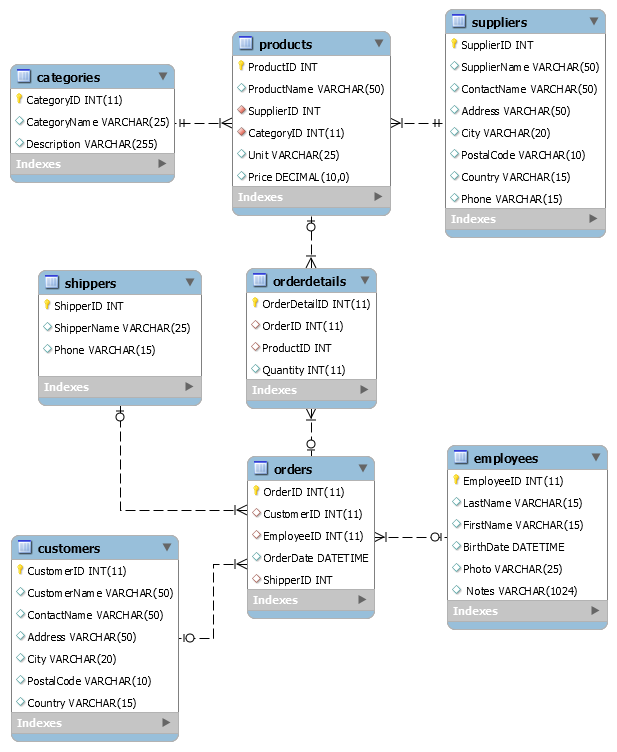
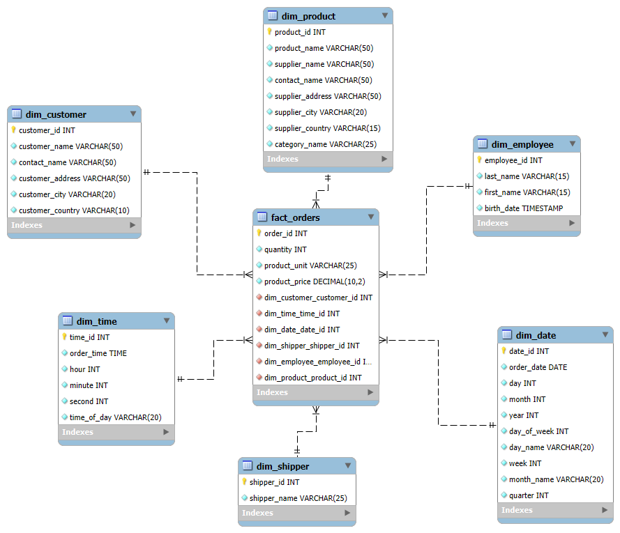
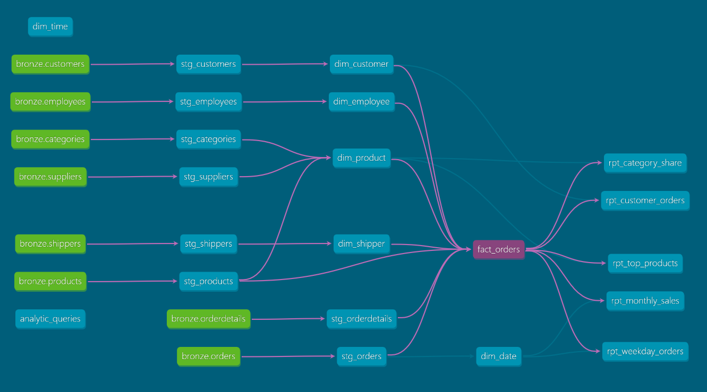
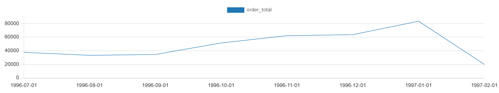
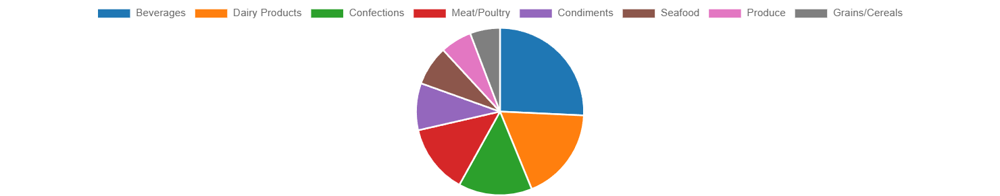
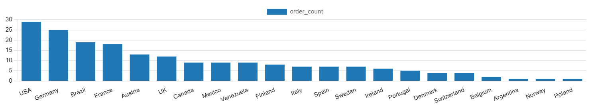
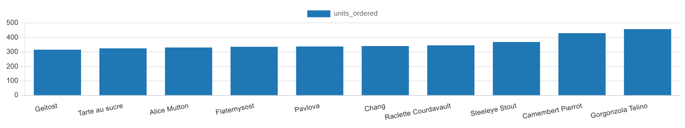
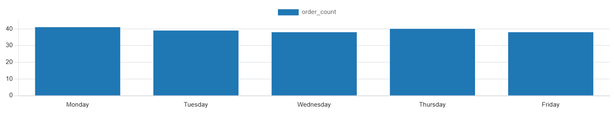

# **ELT proces datasetu Northwind pomocou PostgreSQL a DBT**

Tento repozitár predstavuje ukážkovú implementáciu ELT procesu pomocou PostgreSQL a DBT a vytvorenie dátového skladu so schémou Star Schema. Projekt pracuje s **Northwind** dátami. Projekt sa zameriava na preskúmanie predajov v objednávkach v časových obdobiach. Výsledný dátový model umožňuje multidimenzionálnu analýzu a vizualizáciu kľúčových metrik.

Cieľom ukážky je demonštrovať, ako má vyzerať dokumentácia, implementácia a vizualizácie pre záverečný projekt.

---
## **1. Úvod a popis zdrojových dát**
Northwind predstavuje vzorový obchodný systém, v ktorom sa evidujú zákazníci, produkty, ich kategórie a dodávatelia, zamestnanci, prepravcovia, objednávky a položky objednávok. V tomto príklade analyzujeme dáta o predajoch, kategóriách tovarov, logistike. Cieľom je analyzovať:
- predajnosť kategórií a produktov,
- výnosnosť objednávok,
- početnosť objednávok v rôznych časových obdobiach.
  
Zdrojové dáta pochádzajú z datasetu dostupného [tu](https://github.com/sealbro/northwind/tree/master/pgsql). Dataset obsahuje osem hlavných tabuliek:
- `orders` - informácie o objednávkach
- `customers` - informácie o zákazníkoch
- `employees` - zamestnanci
- `shippers` - prepravná služba
- `orderdetails` - položky objednávky
- `products` - informácie o produktoch
- `categories` - kategórie produktov
- `suppliers` - dodávatelia produktov

Účelom ELT procesu bolo tieto dáta pripraviť, transformovať a sprístupniť pre viacdimenzionálnu analýzu.

---
### **1.1 Dátová architektúra**

### **ERD diagram**
Zdrojové dáta sú usporiadané v relačnom modeli, ktorý je znázornený na **entitno-relačnom diagrame (ERD)**:

<p align="center">
  
  <br>
  <em>Obrázok 1 Entitno-relačná schéma Northwind</em>
</p>

---
## **2 Dimenzionálny model**

V ukážke bola navrhnutá **schéma hviezdy (star schema)** podľa Kimballovej metodológie, ktorá obsahuje 1 tabuľku faktov **`fact_orders`**, ktorá je prepojená s nasledujúcimi 6 dimenziami:
- **`dim_customer`**: Obsahuje demografické údaje o zákazníkoch (meno, kontakt, adresu, mesto, krajinu).
- **`dim_shipper`**: Obsahuje informácie o prepravcoch.
- **`dim_employee`**: Obsahuje informácie o zamestnancoch, ako sú meno a priezvisko, dátum narodenia.
- **`dim_product`**: Obsahuje detailné informácie o produktoch, ako sú názov, dodávateľ, kategória.
- **`dim_date`**: Zahrňuje informácie o dátumoch objednávok (deň, mesiac, rok, štvrťrok).
- **`dim_time`**: Obsahuje podrobné časové údaje (hodina, časť dňa).

Štruktúra hviezdicového modelu je znázornená na diagrame nižšie. Diagram ukazuje prepojenia medzi faktovou tabuľkou a dimenziami, čo zjednodušuje pochopenie a implementáciu modelu. V projekte používame vrstevnú architektúru Bronze → Silver → Gold → Reporting.

<p align="center">
  
  <br>
  <em>Obrázok 2 Schéma hviezdy pre Northwind</em>
</p>

---
## **3. ELT proces pomocou DBT**
ETL proces pozostáva z troch hlavných fáz: `extrahovanie` (Extract), `načítanie` (Load) a `transformácia` (Transform). Tento proces bol implementovaný pomocou DBT s cieľom pripraviť zdrojové dáta zo staging vrstvy do viacdimenzionálneho modelu vhodného na analýzu a vizualizáciu. Pomocou DBT bol vytvorený tento projekt, ktorý má nasledovnú štruktúru:

```text
northwind_dbt/
├── dbt_project.yml                # hlavný konfiguračný súbor projektu a materializácií
├── analyses/                      # priečinok obsahujúci analytické grafy vyexportované z pgAdmin
│   ├── analytic_queries.sql       # SQL súbor obsahujúci analytické príkazy spúšťané cez Query Builder
├── models/                        # SQL modely pre silver a gold vrstvu a reportovanie
│   ├── sources.yml                # konfiguračný súbor pre informáciu o zdrojových údajoch
│   ├── schema.yml                 # konfiguračný súbor pre testovanie atribútov dimenzií a tabuľky faktov
│   ├── staging/                   # silver vrstva pozostávajúca z staging modelov
│   ├── marts/                     # gold vrstva obsahujúca dimenzie a faktovú tabuľku
│   └── reporting/                 # dbt reporting modely
└── ingestion/                     # priečinok obsahujúci SQL import zdrojových dát do bronze vrstvy pomocou príkazu \COPY
    └── data/                      # zdrojové CSV súbory
```

V modeloch používame `source()` na pomenovanie zdrojových bronze tabuliek a `ref()` na odkazovanie medzi DBT modelmi. 

---
### **3.1 Extract (Extrahovanie dát)**
Dáta zo zdrojového datasetu (formát `.csv`) boli nahraté do priečinka `ingestion/data`. Súbory majú podobnú štruktúru, kde oddeľovačom je bodkočiarka.

---
### **3.2 Load (Načítanie dát)**

Dáta zo zdrojového datasetu (formát `.csv`) boli nahraté do Postgre databázy s názvom `northwind_dbt` prostredníctvom SQL súboru `ingestion.sql`, čím vznikla schema `bronze`. Tabuľky boli naplnené dátami pomocou príkazu `\COPY`. Pre každú tabuľku sa použil podobný príkaz:

#### Príklad kódu:
```sql
\COPY bronze.products (productid, productname, supplierid, categoryid, unit, price) 
FROM 'data/products.csv' 
WITH (FORMAT CSV, HEADER TRUE, DELIMITER ';')
```

Klientsky príkaz `\COPY` bol spustený cez **`psql`** z koreňa projektu:

#### Príkaz spustenia:
```bash
psql -h localhost -U postgres -d northwind_dbt -f ingestion.sql
```

Import používa typy podľa údajov v CSV, napríklad `TIMESTAMP`, `INT` a pre cenu `NUMERIC(10,2)`. Stĺpce `_source_file` a `_loaded_at` slúžia ako základné technické metadáta načítania. **Pri prvom spustení však načíta iba šesť referenčných tabuliek**, zatiaľ čo `bronze.orders` a `bronze.orderdetails` zostali prázdne pre dávkovanie pomocou Jupyter notebooku.

---
#### **3.2.1 Batch (dávkové nahrávanie objednávok)**

Dávkovanie bolo vykonané pomocou Jupyter Notebook `batching.ipynb`. Objednávky sa rozdelili podľa `orderdate` na základe hranice (cutoff) **1. január 1997**. Položky objednávok sa priradili do dávok cez `orderid`, pretože samostatný dátum nemajú.

| Krok | Rozsah | Objednávky v bronze | Položky v bronze |
|---|---|---:|---:|
| Po jednorazovom ingeste | Prázdne | 0 | 0 |
| Dávka **A** | Pred 1. 1. 1997 | 152 | 405 |
| Dávka **B** | Od 1. 1. 1997 | 196 | 518 |
| **Opakovanie B** | Rovnaký vstup znova | 196 | 518 |

**Poradie vykonaných krokov pre manuálne vkladanie batchov:**

1. Spustenie úvodného `ingestion.sql`.
2. V notebooku `batching.ipynb` spustenie buniek po **DBT KROK 1** (Batch A), následne v termináli spustenie `dbt build` a overenie rozsahu zmien.
3. V notebooku `batching.ipynb` pokračovanie buniek po **DBT KROK 2** (Batch B), znovu spustenie `dbt build` a overenie rozsahu zmien.
4. V notebooku `batching.ipynb` pokračovanie buniek po **DBT KROK 3**, opätovné spustenie `dbt build` a overenie rozsahu zmien.

Týmto postupom demonštrujeme **idempotenciu**, kde rovnaká dávka nezvýšila počet objednávok ani položiek. 

---
### **3.3 Transform (Transformácia dát)**

V tejto fáze boli dáta zo staging tabuliek vyčistené, transformované a obohatené. Hlavným cieľom bolo pripraviť dimenzie a faktovú tabuľku, ktoré umožnia jednoduchú a efektívnu analýzu.

---
#### **3.3.1 Silver vrstva**

Silver vrstva (`models/staging`) obsahuje modely jednotlivých tabuliek `bronze` vrstvy transformované do podoby, aby mohli vstupovať do dimenzií a faktovej tabuľky. V tejto ukážke staging predovšetkým premenúva a vyberá stĺpce, keďže dátové typy boli určené už pri ingestion, nie je nutné všetky atribúty opätovne pretypovávať. V konfigurácií projektu `dbt_project.yml` sme nastavili materializáciu silver vrstvy na `view`.

#### Príklad kódu:
```sql
SELECT 
    customerid AS customer_id,
    customername AS customer_name,
    contactname AS contact_name,
    address AS customer_address,
    city AS customer_city,
    postalcode AS customer_postal_code,
    country AS customer_country
    FROM {{source('bronze','customers')}}
```

---
#### **3.3.2 Gold vrstva**

Priečinok `models/marts/` obsahuje šesť dimenzií a `fact_orders`. Dimenzie dopĺňajú popisný kontext a faktová tabuľka spája objednávky, ich položky a vybrané dimenzie. 

#### Príklad kódu:
```sql
SELECT
    p.product_id,
    p.product_name,
    s.supplier_name,
    s.contact_name,
    s.supplier_address,
    s.supplier_city,
    s.supplier_country,
    c.category_name 
FROM {{ ref('stg_products') }} AS p
JOIN {{ ref('stg_suppliers') }} AS s ON s.supplier_id = p.supplier_id
JOIN {{ ref('stg_categories') }} AS c ON c.category_id = p.category_id
```
Podobne boli riešené aj ostatné dimenzie `dim_customer`, `dim_employee`, `dim_shipper`, ktoré obsahujú údaje o zákazníkoch, zamestnancoch a dodávateľoch. 

Dimenzia `dim_date` je navrhnutá tak, aby uchovávala informácie o dátumoch vytvorenia objednávok. Obsahuje odvodené údaje, ako sú deň, mesiac, rok, deň v týždni a štvrťrok. Táto dimenzia je štruktúrovaná tak, aby umožňovala podrobné časové analýzy, ako sú trendy hodnotení podľa dní, mesiacov alebo rokov. Z hľadiska SCD je táto dimenzia klasifikovaná ako `SCD Typ 0`. To znamená, že existujúce záznamy v tejto dimenzii sú nemenné a uchovávajú statické informácie.

V prípade, že by bolo potrebné sledovať zmeny súvisiace s odvodenými atribútmi (napr. pracovné dni vs. sviatky), bolo by možné prehodnotiť klasifikáciu na SCD Typ 1 (aktualizácia hodnôt) alebo SCD Typ 2 (uchovávanie histórie zmien). V aktuálnom modeli však táto potreba neexistuje, preto je `dim_date` navrhnutá ako `SCD Typ 0` s rozširovaním o nové záznamy podľa potreby.

#### Príklad kódu:
```sql
SELECT 
    TO_CHAR(d, 'YYYYMMDD')::INT AS date_id, 
    d AS order_date, 
    EXTRACT(day FROM d)::INT AS day,
    EXTRACT(month FROM d)::INT AS month, 
    EXTRACT(year FROM d)::INT AS year,
    EXTRACT(isodow FROM d)::INT as day_of_week, 
    TRIM(TO_CHAR(d, 'Day')) AS day_name,
    EXTRACT(week FROM d)::INT AS week, 
    TRIM(TO_CHAR(d, 'Month')) AS month_name,
    EXTRACT(quarter FROM d)::INT AS quarter
FROM GENERATE_SERIES(
    (SELECT min(order_date)::DATE FROM {{ref('stg_orders')}}),
    (SELECT MAX(order_date)::DATE FROM {{ref('stg_orders')}}),
    INTERVAL '1 day'
) AS gs(d)
```

Faktová tabuľka `fact_orders` obsahuje okrem identifikátora objednávky najmä identifikátory zákazníka, zamestnanca, produktu, prepravcu, dátumu a času, objednané množstvo a katalógovú cenu. Modely gold vrstvy sú materializované ako `table`, pričom pri opakovanom volaní `dbt build` sa prebudujú z aktuálnych údajov a nepridávajú duplicitné riadky prostredníctvom `INSERT`.

#### Príklad kódu:
```sql
SELECT 
    o.order_id AS order_id,
    TO_CHAR(o.order_date, 'YYYYMMDD')::INT AS date_id,
    TO_CHAR(o.order_date, 'HH24MISS')::INT AS time_id,
    dp.product_id AS product_id,
    dc.customer_id AS customer_id,
    de.employee_id AS employee_id,
    ds.shipper_id AS shipper_id,
    od.quantity AS quantity,
    p.product_unit AS product_unit,
    p.product_price AS product_price
    FROM {{ref('stg_orders')}} o
    JOIN {{ref('stg_orderdetails')}} od ON o.order_id = od.order_id
    JOIN {{ref('stg_products')}} p ON od.product_id = p.product_id
    JOIN {{ref('dim_product')}} dp ON od.product_id = dp.product_id
    JOIN {{ref('dim_customer')}} dc ON o.customer_id = dc.customer_id
    JOIN {{ref('dim_employee')}} de ON o.employee_id = de.employee_id
    JOIN {{ref('dim_shipper')}} ds ON o.shipper_id = ds.shipper_id
```

### 3.4 Spúšťanie DBT a dátové testy

Príkazy boli spúšťané z priečinku DBT projektu vo vlastnom prostredí (Anaconda) pre PostgreSQL databázu `northwind_dbt`:

```bash
dbt debug      # overenie nastavenia a pripojenia
dbt build      # vytvorenie modelov + spustenie definovaných testov
dbt test       # iba dátové testy, bez prebudovania modelov
```

V `dbt_project.yml` sú modely staging materializované ako `view`, marts ako `table` a reporting ako `view`. Príkaz `dbt build` zabezpečil vytvorenie závislostí a opakovaným spustením prepočítal tabuľkové modely. Pomocou `models/schema.yml` súboru boli definované základné testy zabezpečujúce kontrolu dát (testy automaticky nevytvárajú PostgreSQL `PRIMARY KEY` alebo `FOREIGN KEY` obmedzenia).

#### Príklad kódu:
```yaml
version: 1

models:
  - name: stg_orders
    columns:
      - name: order_id
        data_tests:
          - unique
          - not_null

  - name: dim_customer
    columns:
      - name: customer_id
        data_tests:
          - unique
          - not_null
```

### 3.7 Graf závislostí a dbt dokumentácia

Dokumentácia k DBT bola vytvorená pomocou príkazov:

```bash
dbt docs generate
dbt docs serve
```

Graf závislostí zobrazuje pôvod dát naprieč všetkými vrstvami.

<p align="center">
  
  <br>
  <em>Obrázok 3 Graf závislostí pre implementovaný projekt</em>
</p>

---
## **4 Analytické reporty a vizualizácia dát v pgAdmin**

V tomto projekte bolo pripravených **päť dbt reportingových modelov** (`models/reporting/`), ktoré pri `dbt build` vznikajú ako pohľady. Všetky dotazy volané z Query Builder v pgAdmin sa nachádzajú v `analyses/analytic_queries.sql`, exportované grafy sa nachádzajú v priečinku `analyses/`. Dotazy boli spustené jednotlivo v pgAdmin a následne vizualizovaný cez **Graph Visualiser** a exportovaný obrázok. 

---
### **Graf 1: Vývoj objednávok podľa mesiacov**
Táto vizualizácia zobrazuje, v ktorých mesiacoch bolo najviac objednávok a ako sa menila ich hodnota. Z grafu je možné pozorovať, že celková hodnota objednávok koncom roku narastala s najvyššou výnosnosťou hneď po novom roku a od februára opäť začala klesať.

```sql
SELECT order_month, order_total 
FROM dbt_reporting.rpt_monthly_sales 
ORDER BY order_month ASC;
```

<p align="center">
  
  <br>
  <em>Graf 1 Vývoj objednávok podľa mesiacov</em>
</p>

---
### **Graf 2: Podiel produktových kategórií**
Táto vizualizácia zobrazuje, ktoré kategórie majú najväčší podiel na orientačnej hodnote objednávok. Z koláčového grafu môžeme pozorovať, že najväčší podiel predajov má kategória `Beverages`, nasledovaná `Dairy Products`, `Confections` a `Meat/Poultry`. Ostatné kategórie mali percentuálny podiel menší ako 10%.

```sql
SELECT category_name, category_total, total_percent 
FROM dbt_reporting.rpt_category_share
ORDER BY total_percent DESC;
```

<p align="center">
  
  <br>
  <em>Graf 2 Podiel produktových kategórií</em>
</p>

---
### **Graf 3: Počet objednávok podľa krajín**
Táto vizualizácia zobrazuje informáciu o počte objednávok na zákazníka podľa krajiny. Graf zobrazuje najväčší počet objednávok z `USA` a `Germany`. Naopak najmenej objednávok je z krajín ako `Poland`, `Norway` a `Argentina`.

```sql
SELECT customer_country, order_count 
FROM dbt_reporting.rpt_customer_orders 
ORDER BY order_count DESC;
```

<p align="center">
  
  <br>
  <em>Graf 3 Počet objednávok podľa krajín</em>
</p>

---
### **Graf 4: Najpredávanejšie produkty**
Táto vizualizácia zobrazuje, ktoré produkty majú najvyšší počet objednaných kusov. Na základe stĺpcového grafu vidím, že najobjednávanejšou položkou je `Gorgonzola Telino` s počtom objednaných kusov 458.

```sql
SELECT product_name, units_ordered, order_count 
FROM dbt_reporting.rpt_top_products 
ORDER BY units_ordered;
```

<p align="center">
  
  <br>
  <em>Graf 4 Najpredávanejšie produkty</em>
</p>

---
### **Graf 5: Objednávky podľa dní v týždni**
Táto vizualizácia zobrazuje, ktoré dni v týždni sa objednávky vytvárajú najčastejšie. Na základe vizualizácie vidíme rovnomerné rozdelenie objednávok počas všetkých dní pracovného týždňa s početnosťou okolo 40 objednávok denne.

```sql
SELECT day_of_week, day_name, order_count 
FROM dbt_reporting.rpt_weekday_orders 
ORDER BY day_of_week ASC;
```

<p align="center">
  
  <br>
  <em>Graf 5 Objednávky podľa dní v týždni</em>
</p>

---
### **Vyhlásenie o používaní AI pri vytváraní projektu**
V tejto časi uveďte, či a ako ste pri vypracovaní projektu používali generatívnu umelú inteligenciu. Formulácia môže vyzerať nasledovne:

Pri vypracovaní projektu bolo použitý GPT-6 Sol na návrh DDL modelov na základe navrhnutej star schemy.

---

**Autori:** Janka Pecuchová a Ľubomír Benko

---

> #### ⚠️ Upozornenie
>
> Tento projekt slúži **`len ako vzorový príklad`** s minimálnymi požiadavkami. Je potrebné vytvoriť **`vlastné, originálne riešenie`**. 
> 
>
> - Identické alebo zjavne veľmi podobné projekty budú hodnotené známkou **`Fx`**.  
> - **Termín odovzdania projektu: `10. 1. 2027`** (termín je záväzný).